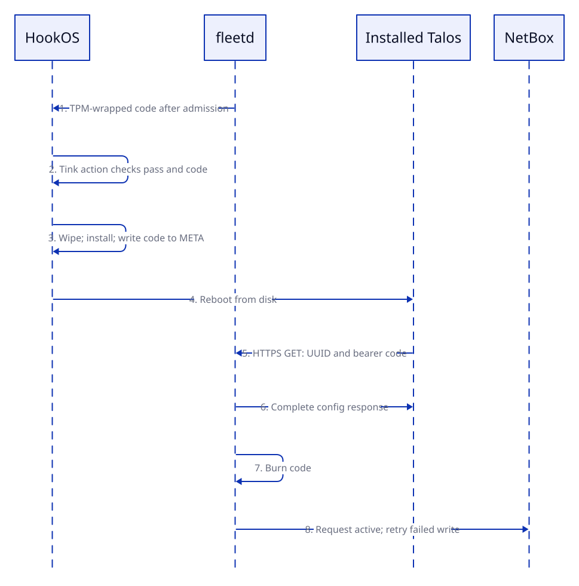

fleetd checks machine identity before installation and boot evidence throughout the node's life. This page explains the checks and configuration delivery.

## Check the machine

HookOS checks its identity on every boot, before tink-agent waits for work. The entrypoint in `images/tink-agent-autoid` sets the clock from `fleet_ntp_server`. It then calls `tink-attest` at `fleet_attest_url`.

The SMBIOS serial identifies the NetBox device. Admission requires a `planned` device and an approved endorsement-key (EK) binding. A device past `planned` that boots HookOS again, for `attest` or a reprovision, needs no new approval: its EKs must match the hashes fleetd's own store holds from its earlier pass, and nothing in NetBox stands in for them.

The nodes file declares that binding. `terraform/netbox/folly` writes it to `approved_ek_hash` and `approved_ek_hash_ecc`. NetBox's latest binding change must come from Terraform's user, configured by `homelab.fleetd.bindingAuthor` in `nix/services/fleetd.nix`.

Every approved EK must match and activate its credential. A manufacturer certificate alone cannot authorize admission.

- An unknown serial or missing binding creates a pending claim. The claim grants no access.
- A different EK is refused and journaled without changing the binding.

fleetd checks the evidence in this order:

1. Check each EK certificate against `apps/fleetd/attest/roots/`.
2. Activate a credential to prove possession of the key.
3. Replay the quoted event log against the class's boot-policy profile. The log must hold at least one event for every PCR the profile quotes, or that PCR must still read its initial value; a profile that pins `boot_applications` also needs a boot application after the separator. A log with no events for a quoted PCR says nothing about it.
4. Read the device and binding changelog again.
5. Issue both certificates only if the binding still matches the session's initial binding.

fleetd alone writes `ek_hash` and `ek_hash_ecc`. They record what a pass proves, for the owner and for SPIRE. They authorize nothing: fleetd holds a device to its own store.

A request that proves nothing writes no verdict. fleetd caps every claimed field before it logs it, counts an invalid request instead of journaling it, rotates `verdicts.jsonl`, and lets no unproven request displace a machine's open session.

Only TPM-authenticated evidence becomes a verdict. Transport errors, timeouts, a missing TPM and evidence without TPM proof cause no quarantine or verdict write.

An unexpected HookOS boot can fail intake without losing the node's identity. fleetd refuses the intake, journals it and increments its counter. This covers workers that fall back to PXE without a requested run.

## Authorize installation

A signed confirmation admits the device in the same process after fleetd reads the binding again.

fleetd requires every field that `terraform/netbox/folly` declares: `talos_class`, `install_disk`, `install_disk_serial`, `bmc_type`, `tpm_version`, `amt`, `secure_boot_expected`, `expected_port` and the primary address.

The attested LLDP port must match `expected_port`. Missing fields or a port mismatch cause refusal and a journal entry. fleetd does not fill in missing declarations.

A provision starts when either condition holds:

- The owner sets `desired_action` to `provision`.
- Auto-provision is enabled and the worker has never run a Workflow.

A control plane requires the owner's request. The Workflow needs no boot mode because the machine already waits in HookOS.

fleetd renders the configuration with talosctl, `clusters/folly/fleet/class-inputs.json` and the worker secrets. The installer image is the digest `clusters/folly/fleet/classes.json` pins for the class, which `.github/workflows/talos-images.yml` writes after each build; fleetd refuses to start while an installing class has no digest. It returns a 32-byte random code wrapped to the TPM.

## Join Kubernetes

Each worker configuration contains its own bootstrap token. fleetd creates `bootstrap-token-<id>` in folly's `kube-system`. The token expires four hours after the configuration's time to live.

The kubelet uses this token for its first client certificate. Later renewals use the certificate. fleetd approves only the matching node name, once per token, then deletes the token after the kubelet receives its certificate.

An admission policy blocks the controller manager from approving bootstrap requests. Its approval binding names an empty group. Both controls live in `clusters/folly/tinkerbell-access/node-client-approval.yaml`.

When the device becomes `active`, the Talos root applies its configuration. Its token, `nojoin.0000000000000000`, matches no Secret. See [Talos Linux](../../platform/kubernetes/talos.md).

## Deliver the configuration

The entrypoint writes the code and proof of a passing check to `/worker/fleet`. The template requires both before wiping the disk. The installer writes the code to `META`.

fleetd starts a run only after the rendering checks pass. Talos then fetches its configuration with the code.

The first fully acknowledged GET consumes the code. fleetd then requests the device's `active` state in NetBox.

An incomplete response leaves the configuration available for retry. This includes a closed connection or an expired write deadline. HEAD and conditional requests are refused.

Unread worker configurations expire after two hours. Control-plane configurations expire after 30 minutes. A configuration whose Workflow is deleted, or ends without success, is dropped at the next pass and its code burned.

## Check the running node

On a running node, `tpm-reattest` sends a LAK-signed quote each hour. This check needs no approved binding. Certificate renewal starts 30 days before expiry. A `planned` device cannot renew.

An authenticated boot-policy failure quarantines a worker, blocks renewal and requests a cordon through `clusters/folly/tinkerbell-access/fleet-controller-cordon.yaml`.

A control-plane failure records a failed verdict and raises an alert without a cordon. It can change eligibility for fleet-owned SPIRE registrations.

The policy's `renew_required_authorities` is empty. Its allowed-authority checks still apply. PCR 0 is stored per BIOS version in `pcr0_by_bios`.

The session's attestation key (AK) signs network reports. LLDP does not authenticate the physical switch port.

[Identity](../../platform/identity.md#renewal) has the renewal and the owner's quarantine lift.

## Update SPIRE eligibility

Each pass writes `/var/lib/fleetd/spire-nodes.json`. Eligible devices must be `active` with a passing verdict. Each entry contains the device name and its `ek_hash` and `ek_hash_ecc` pins.

Devices in decommissioning, failed, quarantined or offline states are excluded. Devices missing from NetBox are also excluded.

The `revoked` list covers known devices that are decommissioning, offline or absent from NetBox. It retains their EK hashes and LDevID SHA-1 fingerprints until the certificate's `notAfter`.

fleetd has no SPIRE credential and never calls the server. The root unit `spire-server-fleet-entries` on spore applies the file:

- It owns registration IDs that start with `fleet-`.
- It removes entries and bans the agent when a node leaves the eligible list.
- It bans each revoked node's agents.
- It changes nothing if the file is malformed or removes more than one node at once.

[Identity](../../platform/identity.md#fleetd-entries) has the boundary with the entries that Nix declares.

## Related

- [fleetd overview](../fleetd.md)
