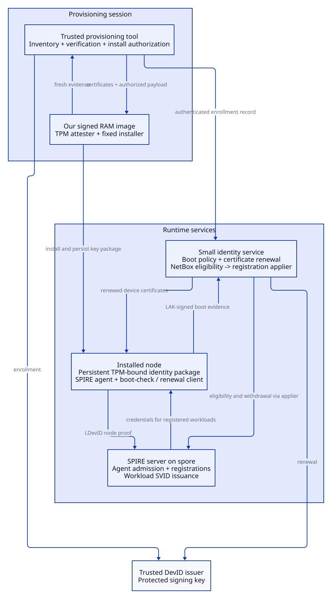

The DIY proposal makes TPM-backed device enrollment and workload identity the purpose of the bootstrap system. A small image runs on the new machine, a trusted tool supervises enrollment and installation, and SPIRE supplies runtime workload credentials. A separate, narrow service continues boot verification and certificate renewal.

This is a design for evaluation. The current deployment remains the [Tinkerbell and fleetd path](../platform/node-lifecycle.md). The [overview and replacement glossary](purchase-to-identity.md#glossary-and-diy-replacements) explain the components being replaced.

## Separate provisioning from runtime identity

The provisioning tool runs on a trusted management host during an enrollment or installation session. It reads the approved NetBox declaration, verifies the target's TPM and boot evidence, arranges certificate issuance, and authorizes a specific installation. It completes configuration delivery and any initial kubelet approval before exiting. Its durable receipts let an owner distinguish an unused authorization from a completed or interrupted attempt.

The target image contains a Linux kernel, hardware drivers, the attestation client and a fixed install routine. Alpine is a candidate base; a minimal initramfs built through the existing Nix image pipeline is another. The image runs from RAM and embeds public trust anchors. Its signature must cover the executable boot contents, and any downloaded installer must match the approved digest. This is an image we maintain, with its own patch and hardware-validation requirements.

The continuous identity service retains the verifier's enrollment records, trusted key bindings and certificate state. It verifies later LAK-signed boot evidence, renews device certificates, reads NetBox lifecycle changes and exports eligibility or withdrawal decisions to the SPIRE registration applier. It can share verification libraries with the provisioning tool. It has no Tinkerbell API, AMT credentials, installer permissions or kubelet-bootstrap approval authority.

The DevID issuer remains available to the enrollment and renewal paths. Its signing authority belongs to the trusted management side, never the target image. Hardware custody limits key extraction; an authorized compromised issuer service can still request signatures. The split is a reduction in responsibilities and credentials, not a claim that the identity service is harmless.

SPIRE's server stays on spore. Its agents stay on the workload nodes, where they identify callers and serve the Workload API. SPIRE node proofs and SVID renewal do not evaluate our PCR/event-log boot policy. The separate identity service keeps that policy active and coordinates eligibility changes with SPIRE.

## Enroll a key that survives installation

The target creates an attestation key and an LDevID signing key inside its TPM. Credential activation establishes the relationship to the approved EK, and fresh quoted boot evidence establishes the accepted boot state. The attestation key certifies the LDevID key, so the issuer signs a certificate for the key proven to reside in that TPM. The issuer also certifies the attestation key as a LAK for later boot checks.

Those operations already exist in `apps/fleetd/client/` and `apps/fleetd/attest/`. They do not intrinsically require Tinkerbell. The current installation adapter does depend on Workflow state, so this proposal replaces that adapter with an authorization bound to the machine, session, disk serial and installer digest. Issuing a device certificate alone never authorizes erasing a disk.

The handoff to the installed OS carries the certificate chain and public/private TPM key blobs for both device and attestation keys. A private blob is protected by the TPM's storage hierarchy; it is not a portable plaintext private key. Certificates in TPM NV do not replace these blobs. Clearing or replacing the TPM invalidates the handoff and requires enrollment again.

The package must reach a persistent location that the installed OS and SPIRE initializer can read. HookOS RAM and the current init container's temporary volume cannot provide that persistence. Talos needs an explicit delivery and storage integration; this design does not assume that copying a file into the temporary installation filesystem makes it survive.

Today `images/spire-agent-tpm/devid-init/` fetches the package from fleetd and falls back to EK attestation if no usable LDevID arrives. The DIY initializer loads the local package, checks its certificate/key consistency and requires `tpm_devid` for this population. A missing or invalid package must stop that identity path. A successful EK fallback cannot count as successful LDevID enrollment.

## Keep the runtime package current

A renewal client on each node sends fresh LAK-signed evidence to the small identity service. That service evaluates policy and lifecycle eligibility before renewing the certificates. The client validates the answer, updates the local identity package consistently with TPM NV, and reloads or restarts the SPIRE agent when required. Updating NV alone leaves SPIRE's local files stale.

A service outage prevents new boot verdicts and renewal but does not immediately invalidate every issued credential. Existing identities follow their validity and renewal rules; alerts must leave enough time to recover before expiry. A new or restarted agent can use its valid local device package without the provisioning tool's lookup endpoint, while still requiring the SPIRE server and appropriate registrations.

NetBox retirement and failed boot verdicts must continue to affect SPIRE eligibility even while no provisioning session is running. The narrow service supplies that continuous identity reconciliation; the existing registration applier can remain a separate privileged component. It must account for other registration owners, both node-attestation paths where enabled, withdrawal safeguards and issued SVID expiry. Disk wiping and BMC power operations remain explicit provisioning or retirement operations outside this service.

## Keep the installer bounded

The first version performs one approved installation and stops on interruption. An explicit new attempt must recheck machine identity, intended disk, installer digest and whether any earlier authorization remains usable. Durable attempt state prevents simultaneous installs and replay; it does not require arbitrary task graphs or a background job scheduler.

Kubernetes admission remains separate from LDevID issuance. For a Talos worker, the provisioning tool preserves the per-node token and node-name approval rule, observes the initial certificate, and removes the bootstrap token. Normal kubelet renewal then uses its own certificate. The identity service does not need the privilege to approve arbitrary node joins.

Enrollment, installation, Kubernetes readiness and SPIRE identity success need distinct observations. NetBox's current `active` transition records configuration delivery. The proposed flow must define an explicit eligibility update for the new identity service, without silently treating a downloaded config or a successful disk action as proof that workload identity works.

## Acceptance is a workload identity after cold boot

Use a spare node and fresh SPIRE agent state for the pilot. Cached agent SVIDs can otherwise hide a broken device-attestation path.

| Exercise | Required result |
| --- | --- |
| Present a wrong EK or replay enrollment evidence. | No device certificate or install authorization. |
| Enroll, install, stop the provisioning tool, block its former endpoints, then cold-boot. | The agent loads its local package and performs a fresh `tpm_devid` attestation. |
| Ask from a registered and an unregistered workload. | Only the registered workload receives its intended SVID; resource access still requires the corresponding authorization. |
| Remove the package or move its blobs to another TPM. | Device attestation fails without silently selecting the EK fallback. |
| Renew the LDevID and LAK. | Local files, TPM NV and the running agent use a consistent renewed identity. |
| Interrupt installation or clear the TPM. | Recovery requires an explicit safe attempt or enrollment; it does not blindly resume a wipe. |
| Fail an authenticated boot check or retire the NetBox device. | The runtime identity service and applier withdraw eligibility with the documented bounds on remaining access. |

A TPM-backed key protects possession and residency. It does not prove the complete chassis supply chain or prevent privileged code on the same machine from using that key. The LDevID is not a certificate of continuous runtime integrity. Those boundaries still apply when the bootstrap image and identity service are our own code.
