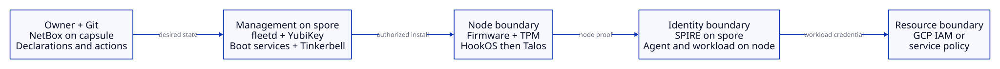
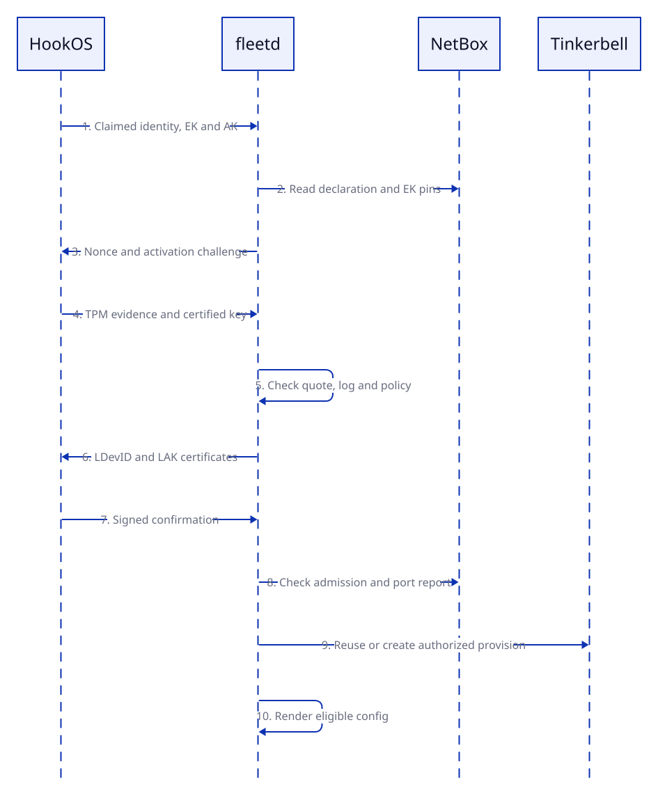
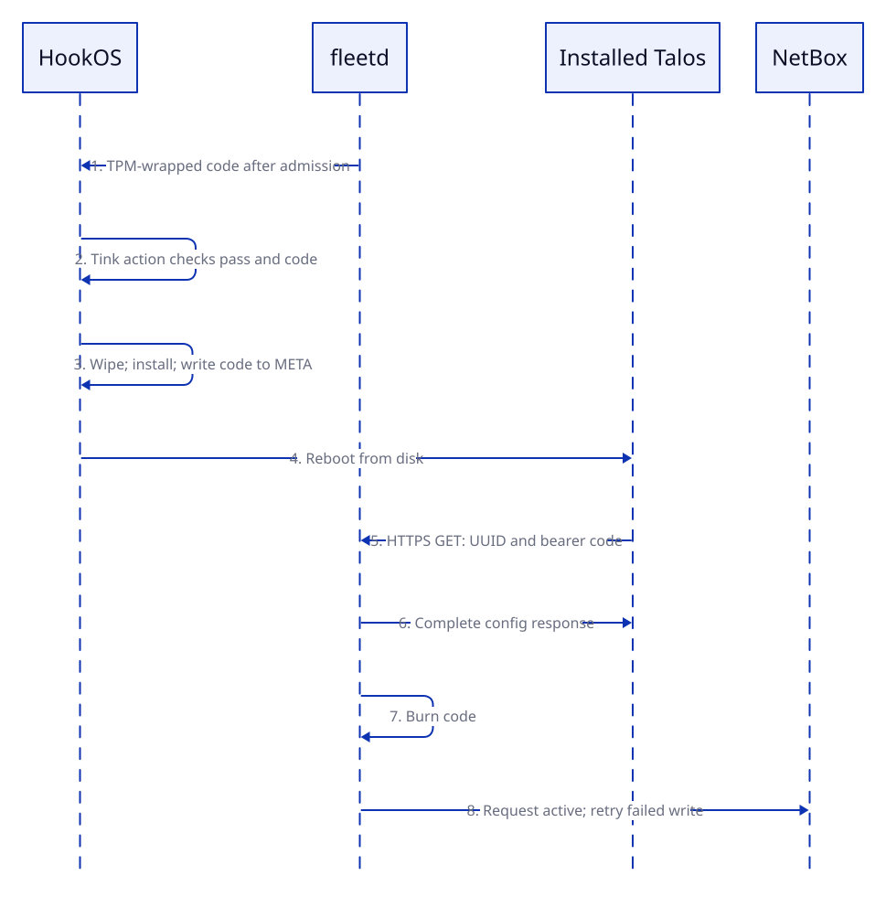
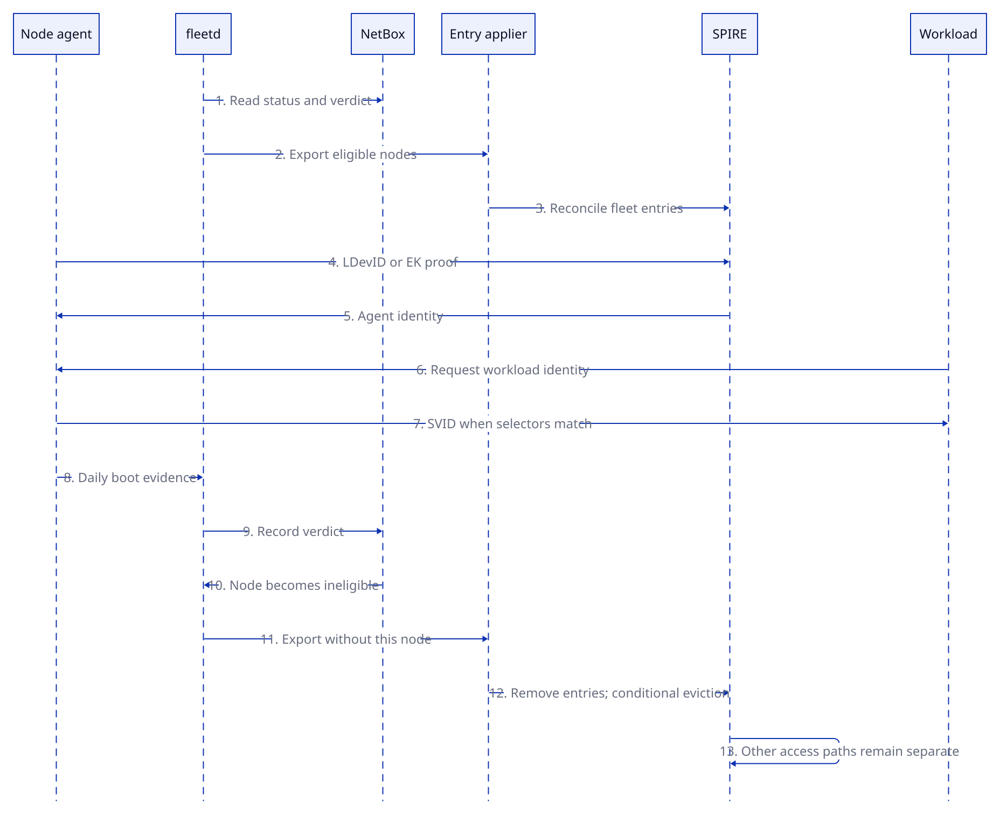

Folly uses a common provisioning system to turn a declared machine into a Talos node with a workload identity. The infrastructure owner uses this design to assess that system and changes to it.

The design separates four decisions: which machine to admit, which boot to accept, which installation to authorize, and which workload to identify. A successful check at one stage does not replace the checks at the other stages.

## 1. Scope and requirements

This design covers the desired state in git. It does not certify the state of a running host. [Node lifecycle](../platform/node-lifecycle.md) describes the operating path. The runbooks carry the commands.

The system must refuse installation when its declaration, evidence or authorization is missing. A failed check before proof of TPM possession must not quarantine another node. A worker must not receive the control plane's signing keys. The owner must be able to retire a node and stop new workload credentials.

Recovery must work while the folly cluster is unavailable. The boot services, fleetd and Tinkerbell therefore run on spore, outside that cluster. This removes a recovery dependency on folly, but makes spore a common failure point.

Offsite provisioning, application authorization and protection against physical hardware attacks are outside this design's implemented guarantees.

### Terms

| Term | Meaning |
| --- | --- |
| TPM | Trusted Platform Module. It protects keys and signs evidence. |
| EK | Endorsement key. A manufacturer certificate can establish that the key belongs to a supported TPM. |
| AK | Attestation key. It signs a quote of the TPM's platform configuration registers, or PCRs. |
| Secure Boot | Firmware checks signatures before it executes a boot image. |
| Measured boot | The boot records measurements in PCRs. A verifier checks a signed quote and the event log. |
| UKI | Unified kernel image. It packages a kernel, initial filesystem and command line in one signed boot image. |
| LDevID | Local device identity. A certificate identifies a TPM key under the lab's device certificate authority. |
| LAK | The locally certified attestation key that signs later boot checks. |
| SVID | SPIFFE Verifiable Identity Document. SPIRE issues this credential to an authorized node or workload. |
| Reconcile | Compare actual state with desired state, then act to reduce the difference. |

The prose uses [ASD-STE100 descriptive writing guidance](https://www.asd-ste100.org/assets/files/ASD-STE100_ISSUE9.pdf): short sentences, consistent technical terms and one topic per paragraph.

## 2. Components and authority

| Component | Input | Decision or output | Authority limit |
| --- | --- | --- | --- |
| Git and Atlantis | The nodes file and OpenTofu configuration | Declared devices, addresses and cables in NetBox | Git does not supply runtime attestation evidence. |
| NetBox | Declarations, owner actions and observations | Lifecycle state and expected device properties | A database record does not prove physical identity. |
| Boot services | Signed release artifacts | iPXE and HookOS | Serving a file does not authorize installation. |
| fleetd | NetBox state and TPM evidence | Certificates, install authorization and Tinkerbell objects | It trusts its policy, issuer and declaration sources. |
| Tinkerbell and Rufio | Workflows and power requests | Disk actions and BMC operations | A workflow executes a decision; it does not establish identity. |
| Talos | Signed installer and first-boot config | The running Kubernetes node | Config delivery does not establish Kubernetes readiness. |
| SPIRE | Node proof and registration entries | Node and workload SVIDs | An identity still needs a resource-specific authorization grant. |

The relationships are sequential and also continuous. fleetd checks the boot before installation. SPIRE checks identity when it admits an agent. Later boot checks and lifecycle reconciliation can restrict future access.

`clusters/folly/inventory/nodes.yaml` holds static machine facts. `terraform/netbox/folly` applies them to NetBox. NetBox holds lifecycle state and observations. The [topology files](topology.md) hold addresses and network identifiers.

The DevID CA and the SPIRE CA have different jobs. The DevID CA certifies device keys. SPIRE issues workload credentials under its own CA. The [PKI chain](../platform/pki.md#chain) defines each signer and its key custody.

## 3. Boot and installation sequence

### Declaration and boot

Automatic installation requires a complete machine declaration, including an approved EK binding in the node's entry. The binding comes from a receiving scan or a supplier record, not from the claim. fleetd honours it only when NetBox's changelog shows Terraform's user wrote it. A planned device without a binding, and an unknown serial, wait as claims that authorize nothing.

UniFi DHCP directs PXE to spore. Firmware loads signed iPXE, which loads signed HookOS. The HookOS command line pins the agent image by digest.

HookOS reads the claimed serial, UUID and MAC. These values select a record. They are not cryptographic proof that the TPM belongs to that chassis.

### Attestation and admission

fleetd checks the EK certificate or existing EK pin. Credential activation proves that the AK and EK belong to the same TPM. A fresh nonce binds the quote to the session. Event-log replay checks that the log agrees with the quoted PCRs.

The policy checks Secure Boot state and accepted signing authorities. Intake requires the HookOS authority. The current `boot_applications` list is empty, so it does not select an exact image version. The `renew_required_authorities` list is also empty; renewal still checks the allowed authorities.

The AK certifies the LDevID key. fleetd checks the certification and key attributes before it issues the LDevID and LAK certificates. A signed confirmation then requests installation admission. A certificate alone does not authorize a disk wipe.

Admission requires the declared fields and a recent signed network report that matches `expected_port`. LLDP describes the reported switch connection. Its signature protects the report in transit; LLDP does not authenticate the switch.

### Installation and config release

Admission requires a planned device. It can reuse an unfinished provision or act on the owner's explicit provision request. Enabled auto-provision can also start a worker's first workflow. It does not automatically provision a control plane.

For an eligible provision, fleetd renders the config and returns a random install code wrapped to the session's TPM. The client unwraps the code. The provision workflow requires both the boot's pass marker and the code before its disk wipe.

The Talos installer writes the code to META. At first boot, Talos sends the UUID and code over HTTPS. This request uses a bearer credential. It does not produce a new TPM proof.

Only one fetch can claim the config at a time. A complete response burns the code. A partial response permits a retry. Config expiry bounds the waiting period. A new render invalidates the earlier code.

After config release, fleetd attempts to set the device active. A failed NetBox update waits for a retry. Active records config release; it does not mean that Kubernetes reports the node Ready.

## 4. Runtime identity and withdrawal

SPIRE supports two node proofs here. The EK plugin checks possession against an allow list, without PCR checks. The LDevID plugin checks the certificate chain and TPM key relationships. Neither plugin performs fleetd's boot-policy evaluation.

Registration entries connect the node identity to workload selectors. A pod receives only identities that match its registration. GCP access also requires an IAM grant for the subject. [Identity](../platform/identity.md) describes the token exchange.

The running node sends daily LAK-signed boot evidence to fleetd. Renewal also replaces expiring device certificates. An authenticated policy failure quarantines a worker and requests a cordon. A control-plane failure records a failed verdict and raises an alert without an automatic cordon. The failed verdict can also remove eligibility for fleet-owned SPIRE registrations.

A cordon prevents new scheduling. It does not stop existing pods or isolate the network. Transport failure is not evidence of an unacceptable boot, so it does not trigger the same quarantine decision.

fleetd exports eligible devices, and the retired ones it holds records of, for the SPIRE registration service. That service removes a node's registrations and bans its agent when the node leaves the export, and bans a retired node's agents on sight. spore declares no static entry. Its EK allow list admits an agent and issues it nothing. A ban stops a new attestation and a renewal, but it does not invalidate an SVID that a consumer already holds before that SVID expires.

An empty NetBox device list preserves the export. A malformed export preserves SPIRE entries. An export that would withdraw or ban more than one node at once changes nothing until the owner allows it. These safeguards avoid accidental mass withdrawal, but they can retain stale access during a fault.

## 5. Design choices and tradeoffs

“Better suited” means a better fit for a stated requirement. It does not mean that one component replaces every function of another.

| Choice | Better suited when | Cost or limit | Position in this design |
| --- | --- | --- | --- |
| HookOS with Tinkerbell | The owner needs power control, disk actions and a common installation environment. | More services and privileged execution on spore. | The declared provisioning path. |
| Direct Talos boot and reset | A Talos-only fleet can accept manual recovery and operating-system-specific actions. | It needs a separate answer for offline power control and other operating systems. | An alternative; it does not implement the current workflow contract. |
| Talos for Kubernetes nodes | The node's purpose is Kubernetes and its configuration follows an API. | General host services need another environment. | The current fleet renderer and installer contract. |
| A general-purpose Linux class | A host needs services outside the Talos operating model. | It needs its own installer, payload, renewal client and boot policy. | A candidate, not an enabled fleet class here. |
| NixOS for anchors | Host services and their dependencies need declarative configuration. | A deploy and host recovery process remain necessary. | The existing anchor configuration under `nix/`. |
| TPM-wrapped install code | The first-boot client supports a config URL but has no device TLS client. | The unwrapped code is a secret that can be copied. | The implemented Talos config path. |
| TPM-backed mutual TLS | A client can use its TPM key for every authenticated fetch. | Client integration and exact issuer validation add work. | An alternative for clients with that capability. |
| LDevID node proof | A certificate should carry a stable node name and support renewal. | The issuer, enrollment and renewal paths become dependencies. | The primary device-certificate design. |
| EK allow list | A known TPM needs a direct registration path. | A key list needs maintenance and establishes no boot state. | A separate configured SPIRE path. |
| YubiKey DevID signer | The issuer key must stay outside ordinary host storage. | Hardware availability and recovery constrain issuance. | The configured fleetd signer. |
| Software DevID signer | Software-only recovery or a controlled test needs simple signing. | Host or state compromise can expose the signing key. | Its CA remains a trust consideration while accepted certificates exist. |

One fleetd process keeps attestation confirmation and installation admission in one call path. It reduces coordination between services. It also concentrates access to NetBox, provisioning and certificate issuance in one process.

The YubiKey prevents ordinary export of its private key. It does not stop a compromised authorized host from requesting signatures. The trusted computing base therefore includes spore and fleetd, as well as the token.

## 6. Experiments and evidence

Evidence has four distinct levels: source analysis, simulator tests, integration tests and hardware observations. A result at one level does not establish the next level. The files below make specific claims reviewable without a timing or production-readiness assumption.

| Question | Evidence in the tree | Conclusion and boundary |
| --- | --- | --- |
| Can a TPM session bind installation authorization to its key? | `apps/fleetd/attest/sim_install_test.go` | Simulator cases exercise install-code delivery and session takeover refusal. They do not test physical TPM latency. |
| Can an unknown or unavailable inventory authorize installation? | `apps/fleetd/attest/sim_fleet_test.go` | Tests cover NetBox failure, unbound and mismatched enrollment, a binding changed or written by another user during a session, and pins after a bound pass (`sim_intake_test.go`, `binding_test.go`). The binding is only as sound as its receiving evidence. |
| Does admission require a complete declaration? | `apps/fleetd/fleet/admit_test.go` | Tests cover missing fields, port mismatch and automatic control-plane refusal. A matching report is not proof of cable location. |
| Can a config be fetched twice? | `apps/fleetd/fleet/install_test.go` | Cases cover concurrent fetches, response completion, expiry and service restart. They do not prevent theft of an unspent code. |
| Does the wipe require the current boot's authorization? | `apps/fleetd/fleet/template_test.go` | Tests exercise the provision script's pass and code gates. They do not constrain a hostile privileged runtime. |
| Why does HookOS carry `talos.platform=metal`? | `nix/images/hookos-folly.nix` | The Talos installer reads the host command line. The signed HookOS image supplies the required argument. |
| Does a boot log represent real firmware output? | `apps/fleetd/attest/testdata/riptide-eventlog.bin` and `apps/fleetd/attest/unit_test.go` | The policy tests use a hardware fixture. A fixture is not a fresh check of a deployed node. |
| Does lifecycle state affect SPIRE registration? | `apps/fleetd/fleet/spire_test.go` | Tests cover eligible states and export safeguards. Full withdrawal also depends on the applier and other registration owners. |

Alternative operating systems require more than a successful disk boot. Acceptance requires authenticated payload delivery, a class-specific renewal policy, an upgrade path and recovery on target hardware. The current Talos policy cannot be treated as a general Linux policy.

## 7. Threat model

Assets include cluster configuration, private keys, disk contents, lifecycle authority and workload credentials. Attackers include an untrusted network client, a substitute machine, a compromised node and a compromised management host.

The model trusts the configured manufacturer roots, firmware measurements, cryptographic implementations, declaration authorities and signing infrastructure. A physical attacker or management-host compromise can invalidate those assumptions.

“Solved” means that the control addresses the specific attack in the row, within the stated assumptions. “Not solved” includes partial controls. It does not mean that the system has no protection.

| Threat | Status | Control and evidence | Remaining boundary |
| --- | --- | --- | --- |
| Replay an earlier attestation response | Solved | Session nonce, credential activation and quote checks in `apps/fleetd/attest/attest.go`. | Assumes trusted verifier state and sound TPM cryptography. |
| Substitute a different TPM for an existing EK pin | Solved | EK matching and activation in `apps/fleetd/attest/attest.go`. | Does not establish who controls the correct TPM. |
| Win first enrollment with a copied serial and MAC | Solved | A planned device admits only the EKs its Terraform-written binding names, in `apps/fleetd/attest/attest.go`. | Rests on the receiving evidence behind the binding and on the Terraform user's token and NetBox admin. |
| Forge a physical switch location | Not solved | `apps/fleetd/attest/network.go` checks signed reports; admission checks `expected_port`. | LLDP observations do not authenticate a cable or switch. |
| Replay an event log that differs from the quoted PCRs | Solved | Quote verification and event-log replay in `apps/fleetd/attest/attest.go`. | Does not establish that firmware measures all relevant code correctly. |
| Run an old but accepted signed image | Not solved | Signing-authority checks apply in the class's profile under `apps/fleetd/attest/policy/`. | Empty `boot_applications` provides no exact-image restriction or version floor. |
| Compromise a host after an acceptable boot | Not solved | Daily quotes provide later boot evidence. | They do not prove runtime memory integrity or remove an attacker. |
| Replay a fully consumed config code | Solved | Burn state and single-fetch exclusion in `apps/fleetd/fleet/configs.go`. | Theft before consumption remains possible. |
| Steal an unspent install code from the node | Not solved | TPM delivery, HTTPS, file permissions and expiry reduce exposure. | The code is a bearer secret after unwrapping, including in META. |
| Trigger quarantine with unauthenticated bad evidence | Solved | TPM-proof gates in `apps/fleetd/attest/attest.go`. | Resource exhaustion and network denial remain possible. |
| Instantly end all access for a retired node | Not solved | Renewal refusal, registration removal and agent eviction restrict new access. | Static entries, EK paths, caches and issued credentials need separate accounting. |
| Join under another node's name with a bootstrap token | Solved | An admission policy refuses the controller manager the approval of any bootstrap request, and its approval binding has no subjects (`clusters/folly/tinkerbell-access/node-client-approval.yaml`); fleetd approves a kubelet certificate only for the node whose own token asked, once, then deletes the token (`apps/fleetd/fleet/joincsr.go`). | The owner approves a join with the cluster-wide token by hand, and the name check is in fleetd's code: a stolen account token can approve any bootstrap request. |
| Rejoin the cluster from a retired worker's disk | Not solved | A worker's config carries its own bootstrap token, which expires hours after the render (`apps/fleetd/fleet/jointoken.go`); the Talos root gives the workers fleetd installs a token no Secret holds; retirement deletes the node's Node, its kubelet's CSRs and its token (`apps/fleetd/fleet/drain.go`). | A disk image from before the wipe keeps the kubelet's client certificate, valid for up to a year, which Kubernetes cannot revoke, and the cluster-wide trustd token. A disk written before the per-node tokens holds the cluster-wide bootstrap token until the owner rotates it. |
| Use the online issuer after management-host compromise | Not solved | YubiKey custody limits key extraction. | Authorized signing access and fleetd's other credentials remain valuable. |
| Continue provisioning through loss of spore | Not solved | Boot services sit outside folly. | Spore remains a common dependency; this is not a redundant provisioning service. |
| Prove that retirement erases all sensitive data | Not solved | The retirement workflow wipes the system disk and erases it whole by NVMe sanitize or format, discard or zeroing, and checks canary blocks afterwards. | A workflow result is not proof of physical media sanitization or erasure of backups. |

## 8. Failure behavior and acceptance

| Failure | Expected behavior | Acceptance evidence |
| --- | --- | --- |
| NetBox cannot answer | Admission refuses the request. Existing credentials are not automatically invalidated. | Outage tests and service alerts. |
| Rendering or authorization fails | The provision receives no install code. | Admission, install and template tests. |
| A config response stops early | The code remains available for retry until expiry. | Config-response tests. |
| fleetd restarts | Configs and burn state survive in the configured tmpfs directory. | Restart tests; a spore reboot still loses tmpfs. |
| A worker fails an authenticated boot check | Successful verdict storage blocks renewal; reconciliation requests a cordon. | Quarantine tests and a controlled hardware exercise. |
| A control plane fails its boot policy | The system records a failed verdict and alerts without automatic quarantine. Fleet-owned registration eligibility can change. | Explicit control-plane cases and operator review. |

A complete acceptance exercise includes a successful install and deliberate failures. The exercise must reject a wrong EK, stale session, wrong port report and spent code. It must also observe Kubernetes readiness separately from config delivery.

Identity withdrawal needs an exercise with both registration owners and both node attestors. The result must record when new issuance stops and when existing credentials expire. A successful export test alone does not satisfy that requirement.

## 9. Change boundaries

An operating-system class, new signing authority or broader renewal policy changes the trust boundary. Such a change needs its own negative tests and target-hardware evidence. A simulator result can establish feasibility without authorizing deployment.

The most important open design decisions are independent EK binding, exact-image policy, complete credential withdrawal and management-host recovery. Their acceptance conditions are concrete: reject a substitute TPM at first admission, reject an unacceptable signed image, demonstrate bounded withdrawal, and restore without folly.

The owner controls lifecycle policy, explicit actions and infrastructure deployment. Enabled auto-provision authorizes an eligible worker's first installation. Git remains the source of desired state. [How changes ship](../platform/how-changes-ship.md) defines which controller applies each layer.
