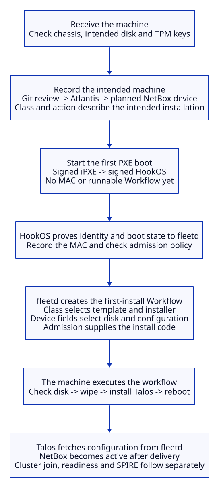

When we accept a machine into folly, we decide what it is, what it should run and whether we trust it with cluster credentials. We record that decision in inventory. The provisioning system then turns the record into an installation and reports the result back.

NetBox is the record that fleetd reads. fleetd chooses and authorizes the work; Tinkerbell supplies the boot and workflow machinery that carries it out. This distinction matters when deciding whether Tinkerbell earns its operational cost: most of the lab's admission policy lives in fleetd.

This brief follows a TPM 2.0 worker through the current path, then examines two alternatives. The alternatives and enrollment improvements are proposals, not enabled provisioning paths. Security engineers can use the linked source and tests to assess the design; this page does not certify a running machine.

## Follow one machine

### Receive it and create its record

We begin with the delivered chassis. We check its label and hardware, identify the disk we intend to erase, and obtain its TPM endorsement-key hashes through a trusted receiving scan or supplier record. An endorsement key, or EK, identifies the Trusted Platform Module; it does not by itself tell us which chassis contains it.

For folly nodes, we enter the static details in `clusters/folly/inventory/nodes.yaml` through a pull request. Atlantis applies those values into NetBox as a device with status `planned`. This is how we populate the NetBox record today; lifecycle requests then come from the owner in NetBox. The [inventory contract](inventory.md) describes which fields Git owns and which observations fleetd adds.

### Choose what the machine should do

Suppose the device is a supported Talos worker and we request `desired_action=provision`. NetBox sends fleetd a webhook, which prompts fleetd to reread the inventory. fleetd also reconciles periodically, so a webhook is a notification, not an executable job description.

The device's `talos_class` selects an entry in `clusters/folly/fleet/classes.json`. That entry chooses the workflow template, installer image and boot policy. The requested action determines whether this run attests, wipes or installs; the device's disk and identity fields constrain where that work may happen.

| NetBox value | How fleetd uses it |
| --- | --- |
| `talos_class` | Selects the class's template, pinned installer and verification policy. |
| `desired_action` | Requests provision, attest or wipe. The `decommissioning` status separately requests retirement. |
| MAC address | Connects the machine to its Tinkerbell Hardware record and boot script. |
| `install_disk`, `install_disk_serial` | Select the intended disk and require its serial to match before destructive work. |
| `bmc_type`, management address | Select the power-control connection; the implemented provider here is Intel AMT. |
| Approved EK hashes | Constrain which TPM may enroll as this planned device. |
| Primary address, `expected_port` | Supply the node address and the expected connection used in admission checks. |

A new device has no recorded MAC yet, so the inventory alone is not enough to submit a runnable workflow. fleetd waits for the first HookOS boot to identify the machine. An explicit request can remain pending while we prepare and boot it.

### Boot into the installation environment

For the first installation, we prepare firmware and start the machine's PXE boot. PXE leads to signed iPXE and then signed HookOS from spore. HookOS is the temporary Linux environment that can inspect hardware, wipe disks and run the Talos installer. Its successful attestation lets fleetd record the machine's MAC in NetBox.

On a later explicit run, when the MAC and AMT connection are known, fleetd can submit the workflow first and have Rufio request power and one-time PXE boot operations. AMT gets the machine into the installation environment; the disk actions still run on the machine itself.

HookOS contacts fleetd before its Tinkerbell agent executes the installation. fleetd checks that the TPM matches the approved inventory binding, proves possession of its keys, and supplies fresh, acceptable boot evidence. It also checks the declaration and a signed report of the observed switch port. The signature protects the report; LLDP does not authenticate the physical switch or cable location. If admission fails, a provision receives no install code and its disk wipe cannot proceed.

A first installation can also start without an explicit action: an eligible planned worker can boot HookOS, pass admission and trigger auto-provision when enabled. That path requires no earlier workflow and no conflicting request. Control planes do not automatically provision. [The provisioning runbook](../runbooks/provision-a-node.md) gives the operating steps and exceptions.

### Run the job and bring the node into service

For an admitted first installation, fleetd creates the Tinkerbell Workflow from the class and device inputs, then records its name in NetBox's `last_workflow`. The machine is already in HookOS, so this path needs no second boot request. fleetd allows one unfinished run per device and adopts an existing run if its NetBox record needs a retry.

fleetd renders the Talos configuration and delivers an install code to the proven TPM. The workflow checks the disk serial and the current boot's authorization before wiping, installing Talos and arranging the next disk boot. Tinkerbell records action progress while fleetd watches for completion and failures.

Talos boots from disk and exchanges the code for its configuration over HTTPS. fleetd consumes the code after the response is acknowledged and marks the NetBox device `active`. That records configuration delivery; Kubernetes readiness is checked separately. Workers provisioned by fleetd also pass a node-name check when fleetd approves their initial kubelet certificate request.

Once the node is eligible, SPIRE can issue identity credentials to its registered workloads. Later boot checks and NetBox lifecycle changes can restrict future issuance. Retirement coordinates disk erasure, power state and cluster cleanup, although credentials already issued can remain valid until expiry.

## What Tinkerbell contributes

Tinkerbell gives us a common way to boot a machine, deliver ordered actions, record progress and control power. Here it also brings an embedded Kubernetes API and etcd, Smee for boot scripts, Tink's controller and server, a node agent, and Rufio for AMT. The [Tinkerbell page](../platform/nixos/tinkerbell.md) shows the deployed components.

The complete lifecycle still needs substantial lab code. fleetd handles admission, conflicting requests, workflow adoption, timeouts, configuration delivery and NetBox updates. Our template supplies disk checks, installer preparation and boot handling. Keeping Tinkerbell means maintaining these integrations as well as the upstream services; removing it means deciding which responsibilities become manual and which need replacement code.

Raw PXE or native UEFI HTTP boot changes how an image reaches the machine. Direct AMT calls change who requests power and boot operations. Neither supplies the executor that runs disk actions or the controller that decides whether a failed installation is safe to retry. iPXE can also provide HTTPS and image verification when configured, while UEFI HTTPS boot depends on the target firmware's support. See [iPXE cryptography](https://ipxe.org/crypto) and [UEFI network boot](https://uefi.org/specs/UEFI/2.11/24_Network_Protocols_SNP_PXE_BIS.html).

## What removing Tinkerbell would look like

### A manual Talos path

The shortest alternative keeps the inventory and signed boot artifacts, uses AMT to request a network boot, and starts Talos in maintenance mode. The owner verifies the target, supplies its machine configuration through the Talos API, watches installation and records the result in NetBox. Later maintenance uses Talos's API; an unresponsive machine still needs AMT or physical access.

This removes the workflow services and their private Kubernetes API. It also makes the owner responsible for selecting the disk, sequencing destructive actions, resolving interrupted installs and recording completion. A small wrapper can generate the command inputs from inventory, but a wrapper with persistent jobs, cancellation and recovery is a controller again.

The security contract changes if we go straight to Talos: that path does not perform today's HookOS attestation and TPM-delivered install-code exchange. Talos's maintenance API accepts an initial configuration without client authentication, so the receiving network must restrict who can reach it. Verifying a console fingerprint can help identify the server; it does not prevent another reachable client from submitting a configuration. [Sidero's installation guide](https://docs.siderolabs.com/talos/v1.14/getting-started/getting-started) describes the maintenance-mode boundary.

This also needs an explicit integration plan for fleetd's per-node join approval and SPIRE eligibility. Completing a direct installation does not automatically satisfy the existing verdict and lifecycle requirements. We should not carry the automated path's assurance claims into a manual run without deciding which checks replace them.

### Keep attestation and replace the executor

A second alternative keeps signed HookOS and fleetd's admission checks, but replaces Tinkerbell with direct AMT control and a small installer agent. NetBox still drives the desired action. After successful admission, fleetd gives that agent a job for this machine and boot, and the agent returns authenticated progress and completion reports.

That preserves the main security decisions, but it is a software project. The replacement needs durable job state, one-run exclusion, timeouts, safe cancellation, restart recovery and rules against replaying a wipe. It must retain disk-identity checks, installer preflight and retirement handling. Configuration delivery is currently tied to Workflow state, so that coupling also needs replacement.

| Choice | What becomes simpler | What we take responsibility for |
| --- | --- | --- |
| Keep Tinkerbell | Reuse its workflow execution, records and BMC controller. | More services, integration code and an agent protocol whose completion reports need stronger authentication. |
| Direct AMT plus manual Talos | Fewer provisioning services and a short Talos-specific operating path. | Human sequencing, recovery and audit records; a different initial-admission boundary. |
| Direct AMT plus a custom HookOS executor | A narrower stack with control over job authentication. | A durable destructive-job controller and its failure cases. This is more than replacing Rufio with a power command. |

For a small Talos-only fleet with infrequent reinstalls, the manual path is a reasonable candidate if attended recovery is acceptable. If unattended reinstall and retirement are requirements, keeping Tinkerbell is the lower implementation-risk choice until a replacement demonstrates those behaviors. Rebuilding a general workflow engine offers little simplification.

A useful pilot uses a spare worker and exercises a normal install, a power cut after wiping, a duplicate request and retirement. Compare the owner interventions and recovery behavior, not just the number of services. These are proposed decision criteria, not completed acceptance results.

## Make EK enrollment easier

Reading an EK is already automated. HookOS discovers the keys, and `tink-attest inspect` can print a local TPM report without contacting fleetd. `mise run attest:approve <serial>` formats a waiting claim as candidate inventory entries. The missing convenience is a trusted receiving workflow that joins those observations to the machine in front of us.

The strongest practical improvement is to make receiving a single guided operation. A proposed receiving tool boots a trusted local image, collects the EKs and disk identity, and asks the owner to check the chassis label. It exports a report, perhaps with a QR code or short comparison digest, to an authenticated workstation that prepares the inventory pull request. The receiving report stays in private records; the pull request carries the required binding fields and an evidence reference. Atlantis remains the writer of the approved NetBox binding.

This removes hash transcription without relaxing admission. The independent observation comes from the receiving process and its trusted console or report transfer. A QR code generated from a remote pending claim alone adds no trust. Pending claims currently precede proof of TPM possession, so even calling one an attested machine would overstate the evidence.

A remote pairing flow could also collect possession and boot evidence while withholding credentials, then ask the owner to confirm a session-bound code on a trusted console. That requires a new enrollment-only protocol: the present verifier requires the approved binding before it challenges the TPM. The console confirmation must identify the exact candidate and key set, not whichever claim happens to be pending for that serial.

A constrained first-boot enrollment mode is another possible design. The owner opens a short enrollment window for one expected machine on an isolated receiving connection; the system requires a manufacturer-certified TPM, verifies possession, pins its EKs and closes enrollment. That is trust on first use: it accepts the risk that an attacker can substitute a machine during that window. Port checks, short expiry and owner confirmation reduce exposure but do not recreate independent chassis-to-key evidence. This policy is not implemented today.

Supplier-signed platform records can avoid a local scan when they bind the chassis identity to the TPM and we validate their issuer and contents. A TPM manufacturer's EK certificate alone is insufficient. The [TCG platform-certificate profile](https://www.trustedcomputinggroup.org/resources/documents/tcg-platform-certificate-profile) defines the richer relationship, but we cannot assume every purchased machine supplies it. AMT can help boot and view a receiving program, but this fleet has no implemented AMT API for reading an authenticated chassis-to-EK binding. Its current HTTP digest transport also needs review before treating remote console receiving as an independently protected channel.

The first improvement to make is automated receiving and PR preparation. Changing the enrollment trust policy should be a separate decision from removing Tinkerbell.

## Which security gaps matter to this decision

The controls make the most sense against two everyday risks: provisioning the wrong machine or disk, and letting an untrusted network client claim a legitimate machine's identity. Inventory checks, disk serial matching, approved EKs and fresh TPM evidence address those risks. Removing Tinkerbell while retaining those checks need not weaken that admission model.

There are also concrete gaps worth prioritizing. Tink authenticates its server to the agent, but the agent has no client credential and identifies itself by MAC. A client can forge progress or completion reports. fleetd corroborates retirement with AMT power state where available, but an off machine is not proof of an erased disk. An authenticated replacement executor could improve this; merely issuing the same work manually over AMT does not authenticate the disk result.

The boot policy accepts signing authorities without an exact-image version floor, so an older accepted signed image can pass. The install code becomes a bearer secret after TPM unwrapping, and acknowledging its delivery does not prove Talos persists the configuration. Power loss in that gap requires a new provision. These are separate image-policy and delivery issues; choosing a workflow engine does not resolve them.

Management-plane compromise is a broader limit. fleetd, the NetBox administrators and the Terraform credential can influence admission. NetBox's HTTP management path also needs trust. Shared age keys and vault access connect cluster administration to management secrets, so running spore outside folly provides recovery independence without complete security isolation. A YubiKey limits private-key extraction but cannot prevent a compromised authorized host from requesting signatures.

Finally, stopping new issuance does not end every existing session. A cordon leaves running workloads in place, issued SPIRE credentials need to expire, and a saved disk can retain a kubelet certificate. Withdrawal safeguards and other registration owners can delay removal too. Those limits require a credential and incident-response policy under either provisioning approach.

The [detailed threat model](folly-design.md#7-threat-model) maps these claims to source, and its [acceptance criteria](folly-design.md#8-failure-behavior-and-acceptance) distinguish tests from hardware evidence. The decision is whether we want automated lifecycle recovery enough to maintain its machinery, and which first-enrollment authority we are willing to trust.
